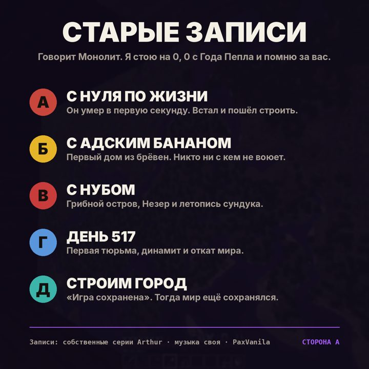

# PaxVanila: Старые записи

*Пролог к «Хронике фронта». Пять миров и пять цивилизаций, которые были до этого мира*

> Эти записи Страж-7 нашёл в архиве Монолита, в самом нижнем ящике, под «Хроникой фронта». На них нет печати «секретно», и подписаны они по-простому, рукой игрока: «с нуля по жизни», «с Адским Бананом», «с нубом». Страж-7 долго не хотел их показывать. Потом сказал: *«Хроника фронта рассказывает, как они воевали. А эти записи рассказывают, откуда они пришли»*.

---

## Что в них странного

Сначала Страж-7 думал, что все записи сняты в одном мире. Потом он сравнил небо, землю и **ключи генератора** и понял: это **пять разных миров**. В каждом жила своя цивилизация, у каждой был свой край земли, и ни один из этих миров не дожил до PaxVanila. От них остались только плёнки.

| Мир | Цивилизация | Запись | Где лежит сейчас |
|---|---|---|---|
| **Мир Картографов** | Одиночки, которые начали с нуля и первыми нарисовали карту | А. «С нуля по жизни» | за западной границей |
| **Мир Деревни** | Мирные строители: жили с жителями деревни и ни с кем не воевали | Б. «С Адским Бананом» | за северо-западной границей |
| **Мир Чародеев** | Искатели Незера; здесь впервые записали летопись сундука | В. «С нубом» | x 6855, z 6689 |
| **Мир ZAG533** | Крепостники: стены, первая тюрьма, динамит и откат мира. «День 517» | Г. «Майн» | за северной границей |
| **Мир Песчаного города** | Градостроители пустыни: склад из рамок, синий зал, башня | Д. «Строим город» | за южной границей |

Ключ генератора виден прямо в одной из записей, и он **не совпадает** с ключом PaxVanila. В другой записи в углу экрана видно **«День 517»**: ни одна держава PaxVanila так долго не жила. А в списке миров первым стоит **«Сервер ZAG533»**. Страж-7 думает, что ZAG533 это старое имя генерала **Zaginsral**, ещё до того, как он стал генералом.

> *«Я долго думал, кто такие Те, Кого Нет. Может быть, это они. Люди, которые жили в пяти мирах до нас, строили, воровали друг у друга железо и ничего не записывали в законы. Только на плёнку»*, Страж-7.

---

## Запись А. «С нуля по жизни, день второй»: Мир Картографов

*Длина записи больше часа. Начинается с надписи «Вы умерли!»*

Это самая старая запись. Игрок начинает с нуля. Он умирает в первые секунды, встаёт и идёт строить.

- Сначала **курятник** за деревянным забором. Потом **огород**: морковь, пшеница, вода в канавке.
- Потом дом из **берёзы и тёмного дуба**: кровать, печь, сундук, верстак. Ничего лишнего.
- Потом **лодка** и выход в море, чтобы посмотреть, где кончается берег.
- И главное: на стене дома висит **огромная карта всего мира**. Она собрана из десятков карт. На ней виден материк с извилистыми реками, большие заливы, острова и прямые дороги к деревням. Это первая карта в истории, которую нарисовал игрок, а не Монолит.

В середине записи происходит странное. Камера вдруг начинает **видеть сквозь землю**: в темноте висят красные и зелёные контуры блоков, как чертёж. В углу записи бегут слова на непонятном языке: *Velocity, NoFall, Trajectories*. Страж-7 честно говорит, что не знает, что это. *«Может быть, язык Безымянных. А может быть, кто-то просто смухлевал. В третьей записи Хроники генерала тоже назовут читером»*.

**Что из этого вынес PAX:** у каждой державы должна быть своя карта. Поэтому на сайте PaxVanila есть общая карта мира, и её видят все.

---

## Запись Б. «С Адским Бананом»: Мир Деревни

*Две записи: короткая, на 4 минуты, и длинная, почти на полчаса.*

В записи два игрока. Второго зовут **Адский Банан**. Это прозвище, и откуда оно взялось, Хроника не говорит.

**Короткая запись.** Утро в деревне жителей. Игроки ходят между домами, заглядывают в сундуки и торгуются с жителями. У колодца стоит железный голем. Никто ни с кем не воюет.

**Длинная запись.** Игроки уходят из деревни в поле и строят **свой первый дом** из брёвен и досок. Сначала каркас, потом стены, потом крыша. Работают до заката. Последний кадр снят на красном небе: дом стоит, факел горит.

> *«Это единственная запись, где никто никого не убил. Я смотрю её, когда устаю от войн»*, Страж-7.

**Что из этого вынес PAX:** новичкам нужно спокойное место для старта. Отсюда в лоре выросли **48 часов защиты новичка** и мирная **Башня на 0, 0**.

---

## Запись В. «С нубом»: Мир Чародеев

*Длина около получаса. Деревня, грибной остров, Незер.*

Игрок водит новичка по миру. Они проходят деревенский дом с сундуками, плывут к **грибному острову** с огромными красными грибами и спускаются в **Незер**. Там они долго ходят в красной темноте.

Самое важное в этой записи это **журнал**. Посреди записи на экране открывается летопись сундука, и в ней чёрным по белому написано:

- **Место:** x 6855, z 6689. Это ещё дальше, чем Дальний сектор.
- **ZAG533 забрал 64 лазурита.**
- **ZAG533 забрал 24 золотых слитка.**
- **ZAG533 положил и снова забрал железо**, и так несколько раз за сутки.

Сразу под журналом идут две строки: **«ZAG533 был убит 055das__»**, и ещё раз то же самое. А потом: **«055das__ получил достижение "Чародей"»**.

Страж-7 считает, что это **первое расследование** в истории. Кто-то пришёл к сундуку, открыл летопись и проверил, кто что взял. Через год, в «Гулаге и порохе», генерал так же будет искать пропавший порох. Только в тот раз летописи под рукой не было.

**Кто такой 055das__**, неизвестно. Он дважды победил будущего генерала и сразу стал Чародеем. Больше его имя нигде не встречается.

**Что из этого вынес PAX:** у каждого сундука должна быть летопись. На сервере PaxVanila это делает **CoreProtect**: любой спор о краже решается по журналу.

---

## Запись Г. «Майн»: Мир ZAG533, День 517

*Самая длинная запись, два часа. Сервер ZAG533, версия мира 1.16.1, в углу «День 517».*

Это запись уже не о выживании, а о жизни города.

1. **Деревня с каменными стенами.** На улицах торговые лавки, у домов стоят сундуки. По деревне ходит **Telorfind** в алмазной броне. Ещё до войны он здесь сосед, а не враг.
2. **Решётка и огонь.** В одном из домов есть клетка из железных прутьев, а за ней горит огонь. Страж-7 уверен: это **первая тюрьма**. Через год такая же решётка станет **Гулагом** Дальнего сектора.
3. **«Я хочу новую крепость тоже».** Эти слова Telorfind пишет в чат, стоя у сундуков. Генералу крепость, и Telorfind тоже хочет крепость. С этой фразы в Хронике начинается соперничество.
4. **Поход под воду.** Игроки ныряют к **подводному храму** и ломают его стены из губки и призмарина.
5. **Каменный замок.** Над рекой поднимается замок с башнями и мостом.
6. **ТНТ.** В конце записи в кадре ящик динамита. Потом взрыв, и пол-замка превращается в воронку.
7. **Откат.** После взрыва чат заполняют строки: *«Modified 1/26 chunks… 2/26… 10/26…»*. Мир **сам возвращается назад**, блок за блоком. Замок снова стоит, будто взрыва не было.

> *«Это я помню лучше всего»*, говорит Страж-7. *«Взрыв, а потом время идёт назад. В нашем мире так уже нельзя. Поэтому у нас есть закон: город нельзя снести в ноль»*.

**Что из этого вынес PAX:** раз мир больше не умеет откатываться сам, его нужно беречь. Это вторая половина закона **«анти-руины»**.

---

## Запись Д. «Строим город»: Мир Песчаного города

*Самая большая запись, тоже два часа. Это прямой эфир: в углу экрана видно, как зрители присылают по два-четыре рубля.*

Здесь уже не выживают, здесь строят **город**. Стоит он у пустыни на берегу моря.

- **Склад со стеной из рамок.** Вся стена от пола до потолка увешана рамками, и в каждой висит предмет: морковь, железо, кирпичи, изумруды. Под каждой рамкой стоит свой сундук. Это первый склад, где сразу видно, что где лежит.
- **Синий зал.** Пол выложен синим и голубым бетоном, стены сделаны из призмарина, светятся морские фонари. Похоже на подводный храм, только построенный своими руками и на суше.
- **Башня из песчаника.** Над пустыней стоит многоэтажная башня с окнами в каждом ярусе. Внутри коридоры, лестницы и двери.
- **Карта на столе.** В синем зале лежит карта: жёлтый материк пустыни, зелёный лес и синее море. С неё начинается планировка города.
- **Обсидиановые комнаты.** Под землёй строители долго ломают и ставят обсидиан. Что они там делали, запись не объясняет.
- **Таблички у входов.** На стенах висят таблички с подписями, куда ведёт каждый вход.

Сервер то и дело пишет в чат: *«Игра сохранена»*. Страж-7 говорит, что это самые важные слова во всех старых записях. *«Мир тогда сохранялся сам. Потом настал день, когда он не сохранился»*.

**Что из этого вынес PAX:** у города должен быть план, склад и вход, который видно издалека. Из этой записи в лоре выросла идея **порта и рынка в каждой столице**.

Эту запись Страж-7 потом расшифровал целиком: таблички, Белый дом, закон «килл и +суд» и уход на лодке. Читайте главу [Город Дубай](строим_город.md).

---

## Запись Е. «Супер-пушка ТНТ»: Полигон

*Запись прямого эфира, почти час. Первые пять минут на экране только надпись «СТРИМ СКОРО НАЧНЕТСЯ».*

Страж-7 долго не знал, куда положить эту плёнку. Это не шестой мир: здесь никто не жил. Это **Полигон**, плоская пустыня из одного песка до самого горизонта, без деревьев, без воды и без жителей. Мир сделали только для одного: проверить, как далеко можно бросить динамит.

1. **Первые пробы.** Раздатчики, вёдра воды и кучка динамита прямо на песке. Динамит взрывается и разлетается куда попало. Ничего не летит прямо.
2. **Ствол.** Строитель выкладывает из белого **кварца** длинный канал и заливает его водой. Вода не даёт взрыву разорвать сам ствол: взрыв толкает, но не ломает. По бортам встают ряды **повторителей**, по верху идёт кольцо красной пыли, а в казённой части, в кварцевом «кармане», стоят два **раздатчика** друг на друге. Это сердце пушки: отсюда идёт заряд.
3. **Первый выстрел.** Над каналом поднимается дым, и по прямой через пустыню ложится **цепочка воронок**: пять, шесть ям, последняя дальше сотни блоков. Песок разлетается, а кварцевый ствол стоит целый.
4. **Супер-пушка.** Строитель ставит рядом второй ствол. Теперь у пушки **два ствола по три канала**: посередине цепь горящего динамита, по бокам вода. Один раз он ставит ствол вертикально, и столб динамита уходит прямо в небо.
5. **Мир не выдерживает.** На последних залпах в чате пишет сама игра: *«Ошибка OpenGL: Out of memory»*. Мир начинает задыхаться от числа взрывов. Строитель пытается выключить погоду на «9999999» и получает отказ: даже у неба есть предел.
6. **После Полигона.** Во второй половине той же плёнки строитель уже не в пустыне. Он ходит по чужому городу с бирюзовыми башнями. На табличках написано: **«Склад Города Дубай»**, **«Белый дом игрока ZAG533, Мэр-ZAG533»** и **«Вход на склад посторонним — килл и +суд»**.

> *«Посмотрите на порядок»*, говорит Страж-7. *«Сначала пушка в мёртвой пустыне. Потом город, где у склада уже стоит табличка про суд. Кто-то сначала научился бросать динамит на сто блоков, а потом пришёл туда, где живут люди. Хорошо, что там уже были законы»*.

**Что из этого вынес PAX:** оружие, которое бьёт дальше, чем видно, надо держать в правилах, а не в руках. Поэтому на сервере **Супер-пушка ТНТ** есть, но она ломает только то, что Towny разрешает в бою, через 30 минут всё возвращается, и **у башни она не стреляет**. Новичок под защитой её не может ни купить, ни зарядить.

**Связи.** Город **Дубай** и мэр **ZAG533** ведут прямо к Записи Г и к главе [Город Дубай](строим_город.md): это тот же ZAG533, будущий генерал Zaginsral. А «пропавший порох» из второй записи Хроники фронта Страж-7 теперь ищет на Полигоне: столько динамита, сколько сгорело в этой пустыне, не было ни на одном складе.

---

## Как старые записи связаны с Хроникой фронта

| Старая запись | Что потом случилось в Хронике |
|---|---|
| Сервер ZAG533, «День 517» | Генерал Zaginsral и его камера в Дальнем секторе |
| Telorfind: «я хочу новую крепость тоже» | Запись 1, «Война за деревню»: две крепости, одна деревня |
| Клетка с огнём за решёткой | Запись 2: первый Гулаг Дальнего сектора |
| Журнал сундука: 64 лазурита, 24 золота | Запись 2: пропавший порох и следствие генерала |
| ТНТ и откат мира | Запись 3: динамит на небесных островах, закон «анти-руины» |
| Карта на стене дома | Карта фронта по дням, 18–23 января 2021 |
| Город у пустыни, склад и синий зал | Столицы и порты PaxVanila |
| Слова в углу экрана, взгляд сквозь землю | Запись 3: «его приняли за читера» |
| Супер-пушка ТНТ на Полигоне, город Дубай мэра ZAG533 | Запись 2: куда делся порох; осадные орудия PaxVanila и правило «У башни не стреляют» |

---

## Пластинка «Старые записи»

Монолит собрал эти записи на одну пластинку: пять дорожек, сторона А. На сервере её можно поставить в проигрыватель вместе с тремя другими пластинками Архива Монолита: «Хроника фронта», «Устаревшая запись» и «Эфир Монолита».

Датапак пластинок: [PaxVanila_Discs_v1.zip](../files/PaxVanila_Discs_v1.zip). Ресурспак со звуком сервер выдаёт сам при входе.

---

## Открытые загадки

- **Пять миров.** Ключи генераторов не совпадают ни друг с другом, ни с PaxVanila. Почему все пять миров погасли и как их записи попали в архив Монолита?
- **055das__.** Кто он и почему больше нигде не появляется?
- **Адский Банан.** Кто скрывается под прозвищем и почему он ушёл?
- **Полигон.** Где лежит песчаная пустыня с кварцевым стволом? Если её найти, в воронках может лежать пропавший порох Хроники.
- **x 6855, z 6689.** Что ещё лежит в сундуке на этих координатах? Если граница PaxVanila когда-нибудь дойдёт туда, это можно сделать ивентом.

> *«Мир до нас не был ни хорошим, ни плохим. В нём строили курятники, плавали к грибным островам, воровали золото и взрывали замки. Потом всё откатывали назад. А мы откатить ничего не можем. Поэтому мы и договорились»*.
> Страж-7
